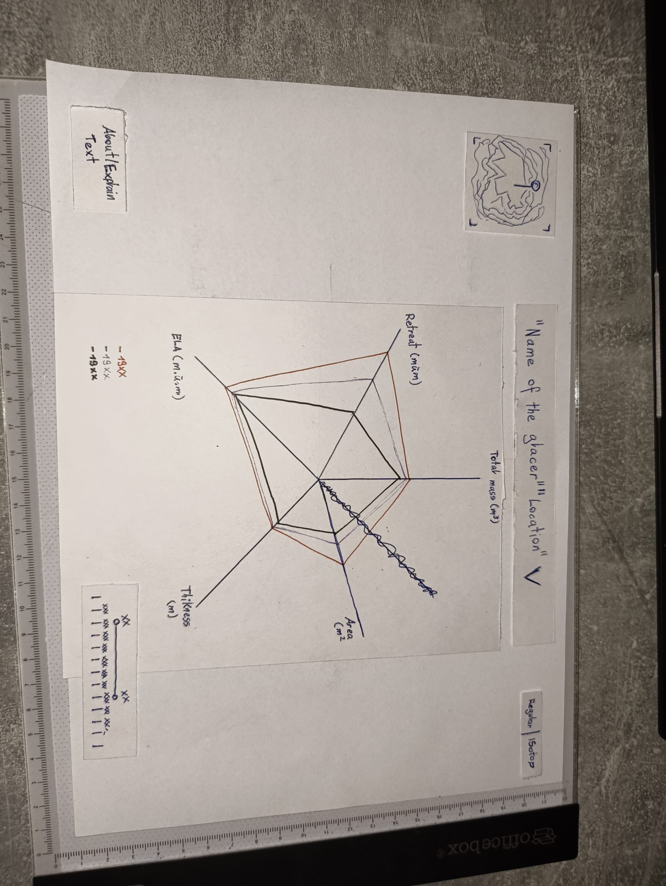

# 01 – Overview (Regular mode)

- **Description:** Start screen. A radar chart in the centre with five axes: Total mass (m³), Retreat (m), ELA (m a.s.l.), Thickness (m), Area (m²). Each selected year is one closed polygon in its own colour, overlaid so the glacier's "shape" can be compared across years (oldest = largest). Around the chart:
  - Top left: map thumbnail of the glacier outline with a pin, corner brackets show it can be expanded
  - Top centre: dropdown with glacier name and location
  - Top right: toggle "Regular | Isotype", Regular is active
  - Bottom left: About / explanation text on how to read the chart, plus data credit "Data: GLAMOS, CC BY 4.0"
  - Bottom centre: legend, one coloured line + year per polygon
  - Bottom right: year slider with a handle at each end and one tick mark per year
- **Trigger:**
  - Click the glacier name or ˅
  - Click the map thumbnail
  - Drag a slider handle or click a tick
  - Click "Isotype" in the toggle
  - Hover a polygon corner or a legend entry
- **Response:**
  - Glacier name / ˅ → list opens → see `02_glacier_dropdown`
  - Map thumbnail → see `03_map_expanded`
  - Slider → polygons for the new year range animate in or out, legend updates
  - "Isotype" → radar chart breaks apart into pictograms → see `04_isotype_view`. Glacier, years and map stay the same
  - Hover corner → tooltip with metric, year, exact value and unit
  - Hover legend entry → that year's polygon highlights, others dim
- **Data:**
  - Total mass: `data/[volumechange file].csv` → [columns]
  - Retreat: `data/[lengthchange file].csv` → [columns: glacier, year, cumulative length change]
  - ELA: `data/[massbalance glacier-wide file].csv` → [ELA column, if it exists]
  - Thickness: `data/[icethickness file]` → [columns]
  - Area: `data/[inventory file].geojson` → [area]
  - Each axis is scaled on its own (min to max for that metric), since units differ
- **States:**
  - Default glacier and default years loaded
  - Loading data
  - A metric missing for this glacier or year (that axis point is left out and marked "no data")
  - Slider dragged to a new range
- **Remarks:**
  - To confirm: default glacier and default years
  - To confirm: slider picks a range (every year in between drawn) or a few single years. Many polygons get hard to read
  - To confirm: "Total mass (m³)" is a volume unit. GLAMOS has mass balance (water equivalent) and volume *change*, not total mass. Decide what this axis shows
  - To confirm: a higher ELA means a worse state, the opposite of the other axes. Invert it so "bigger shape = healthier glacier"?
  - To clarify: the wavy line drawn between the Area and Total mass axes
  - Thickness is from radar surveys 1999 to 2015, not yearly. Area comes from inventories (1850, 1931, 1973, 2010, 2016, 2023) only
